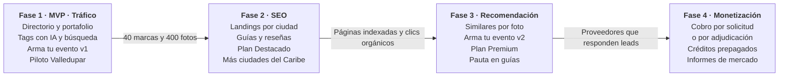

# Visión, fases y actores

Festeka es un directorio y buscador de proveedores de eventos en Colombia donde cada marca, servicio y foto está etiquetada con un motor de tags, de modo que una búsqueda como "decoración Bob Esponja Valledupar" devuelve fotos reales de fiestas y el decorador que las hizo. El producto central es Arma tu evento: la plataforma sugiere proveedores por categoría para la fiesta del cliente y él elige con quién cotizar. El piloto arranca en Valledupar y se abre ciudad por ciudad.

**Problema.** Hoy quien organiza un evento busca proveedores en Instagram, WhatsApp y referidos. La información está dispersa, no se puede filtrar por temática y pedir cotizaciones a cinco proveedores toma días.

**Propuesta de valor.**

- **Para el cliente:** encontrar por lo que quiere ver (temática, estilo, tipo de evento, presupuesto) y no solo por categoría; recibir un plan con proveedores recomendados por categoría, ajustarlo con los suyos y pedir todas las cotizaciones en un solo envío.
- **Para la marca:** un perfil indexable en Google, un portafolio que trabaja como vitrina SEO y solicitudes de clientes que ya saben lo que quieren.
- **Para la plataforma:** un activo de datos (qué se busca, en qué ciudad, a qué precio) que sostiene la monetización.

"Festeka" es el nombre de trabajo; se cambia en un solo lugar (dominio, marca y textos) antes del lanzamiento.

## Fases del negocio

El negocio avanza en cuatro fases y cada una depende de la anterior: sin catálogo no hay SEO, sin tráfico no hay datos para recomendar y sin las tres no hay a quién venderle cotizaciones.

La fase 1 es el MVP que se implementa tras la aprobación; las puertas son las metas que habilitan invertir en la siguiente.

## Actores y roles

Cinco roles cubren el MVP; el rol de agencia/organizador se agrega en la fase 3.

| Rol | Quién es | Qué hace en la plataforma |
| --- | --- | --- |
| Visitante | Persona buscando proveedores, sin cuenta | Busca, filtra, ve perfiles y fotos, contacta por WhatsApp |
| Cliente registrado | Visitante con cuenta (Google o celular + OTP) | Guarda favoritos y tableros de inspiración, pide cotizaciones, deja reseñas |
| Proveedor (dueño de marca) | Decorador, catering, fotógrafo, DJ, etc. | Gestiona su perfil, sube portafolio, etiqueta, responde cotizaciones, ve estadísticas |
| Colaborador de marca | Empleado del proveedor | Sube fotos y responde solicitudes según permisos |
| Curador / Admin | Equipo Festeka | Aprueba marcas y fotos, gobierna la taxonomía, abre ciudades, modera reseñas |
| Organizador / agencia (fase 3) | Wedding planner o agencia | Arma eventos con varios proveedores y los acredita en las fotos |

## Monetización y métricas

La recomendación es cobrar al proveedor, nunca al cliente, y empezar con suscripción de visibilidad antes que cobro por lead. Arma tu evento es gratis para el cliente; en la fase 4 se cobra al proveedor la solicitud recibida o la adjudicación, nunca el puesto en la recomendación. Es el modelo de los grandes directorios de bodas, que viven de publicidad y perfiles premium de proveedores ([Sharetribe](https://www.sharetribe.com/create/how-to-build-marketplace-for-event-planning/)). El cobro por lead, como el de Thumbtack, se cobra aunque el lead no se convierta ([Think Insights](https://thinkinsights.net/index.php/digital-transformation/thumbtacks-two-sided-marketplace)) y genera rechazo si el volumen es bajo, así que se deja para cuando haya tráfico.

**Fuentes de ingreso por fase.**

| Fuente | Cómo funciona | Fase |
| --- | --- | --- |
| Perfil gratis | Perfil, 3 álbumes, búsqueda normal; sirve para llenar el catálogo | 1 |
| Plan Destacado | Álbumes ilimitados, posición "Destacado" en su categoría y ciudad, estadísticas completas | 2 |
| Plan Premium | Destacado + aparece en landings de temática, video en portada, estadísticas avanzadas | 3 |
| Cotizaciones | Créditos por solicitud recibida o comisión al adjudicar, según lo que se valide con proveedores | 4 |
| Patrocinios y pauta | Banners de locaciones y marcas en guías editoriales | 3 |
| Informes de mercado | Tendencias agregadas y anónimas: temáticas más buscadas por ciudad, precios promedio, temporadas | 4 |

Los precios de cada plan se definen después de entrevistar a 15–20 proveedores del piloto; no conviene fijarlos antes.

**Métricas por fase.**

| Fase | Métrica norte | Métricas de apoyo |
| --- | --- | --- |
| 1 Tráfico | Marcas activas y fotos etiquetadas por ciudad | Sesiones, búsquedas por sesión, clics a WhatsApp |
| 2 SEO | Clics orgánicos desde Google (Search Console) | Páginas indexadas, posición media en "[categoría] [ciudad]" |
| 3 Recomendación | Leads por sesión | CTR de recomendaciones, usuarios recurrentes, tableros creados |
| 4 Monetización | Ingreso mensual recurrente | Proveedores pagos / activos, cotizaciones adjudicadas, tasa de respuesta de proveedores |

## Fuentes

- [How to build a marketplace for event planning — Sharetribe](https://www.sharetribe.com/create/how-to-build-marketplace-for-event-planning/)
- [Thumbtack's Two-Sided Marketplace — Think Insights](https://thinkinsights.net/index.php/digital-transformation/thumbtacks-two-sided-marketplace)

---
[Índice de la documentación](README.md) · [Roadmap](../ROADMAP.md)
