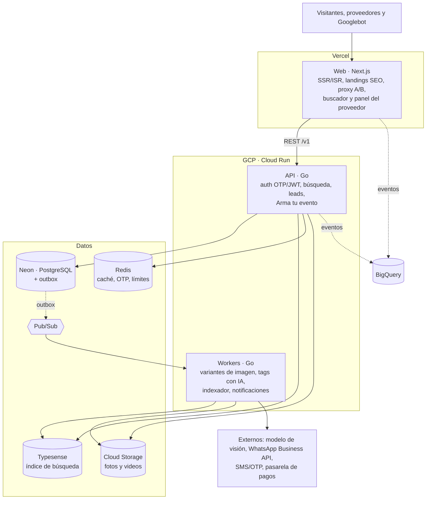

# Arquitectura técnica

El frontend Next.js vive en Vercel. La API y los workers en Go corren en Cloud Run (GCP). PostgreSQL en Neon es la fuente de verdad, Typesense es el índice de búsqueda y Pub/Sub mueve el trabajo asíncrono. Todo es sin estado, lo que mantiene el costo bajo mientras el tráfico es pequeño. La decisión del stack está en [ADR 0002](adr/0002-stack.md).



El navegador sube fotos directo a Cloud Storage con URL firmada; la API solo registra el archivo y publica el evento que procesan los workers.

| Capa | Tecnología | Por qué |
| --- | --- | --- |
| Frontend | Next.js 16 (App Router, TypeScript, Tailwind 4) en Vercel, PWA | SSR e ISR para SEO, previews por PR, `proxy.ts` para el A/B en el borde |
| Backend | Go 1.24 en Cloud Run (stdlib `net/http` + `pgx` + `sqlc`), OpenAPI | Binarios livianos, arranque rápido, mismo lenguaje en API y workers |
| Base de datos | Neon PostgreSQL 16 (+ `pgvector`, `pg_trgm`) | Postgres administrado y serverless, ramas por PR para pruebas |
| Búsqueda | Typesense (Cloud o autoalojado en una VM) | Tolerancia a errores, facetas, sinónimos y vectores |
| Caché | Redis (Upstash o Memorystore) | Búsquedas frecuentes, códigos OTP, límite de peticiones |
| Asíncrono | Pub/Sub + workers en Cloud Run | Variantes de imagen, etiquetado con IA, indexación, notificaciones |
| Archivos | Cloud Storage + CDN | Originales privados, variantes públicas en caché |
| Analítica | BigQuery + Looker Studio | Eventos de producto, análisis del A/B y producto de datos |
| Infra y CI/CD | Terraform, GitHub Actions, Artifact Registry | Entornos dev, staging y prod reproducibles |
| Observabilidad | Cloud Logging/Monitoring, logs de Vercel, OpenTelemetry | Alertas de error y latencia por servicio |

## Estructura del repositorio

```text
apps/web/          Next.js (landing, Arma tu evento, luego panel y admin)
services/api/      API Go (Cloud Run)
services/workers/  Workers Go (sprint 3)
infra/             Terraform (sprint 1)
docs/              Esta documentación y los ADR
```

## Entornos

| Entorno | Web | API | Base de datos |
| --- | --- | --- | --- |
| Local | `pnpm dev` | `go run ./cmd/api` | Rama de Neon de desarrollo |
| Preview | Vercel preview por PR | Cloud Run revisión con tag | Rama de Neon por PR |
| Producción | Vercel (`festeka.co`) | Cloud Run `api` | Rama principal de Neon |

La app móvil nativa queda fuera del MVP; si se necesita, Flutter consume la misma API.
